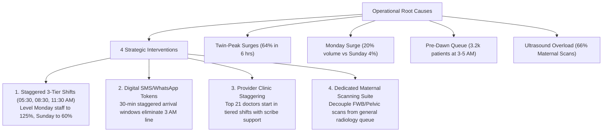

# Hospital Patient Flow & Wait-Time Intelligence (PULSE)
### Outpatient Operations & Clinical Throughput Analytics | SQL & Microsoft Excel 365

An end-to-end healthcare analytics case study analyzing **49,912 outpatient visits** across 24 months to uncover queue bottlenecks, model arrival surges, and optimize physician and diagnostic scheduling.

---

## Executive Summary

Hospital outpatient departments frequently suffer from unpredictable patient arrival surges, extended waiting queues, and diagnostic delays. This project analyzes 2 years of electronic health records (EHR) from an active hospital outpatient department to diagnose the root causes of queue latency and propose evidence-based operational interventions.

### Key Results & Proposed Impact
- **Current State:** The hospital manages ~70 visits per operating day with a **27.0-minute median wait**, but **22.4% of patients (11,157 visits) suffer severe delays exceeding 1 hour** ($P_{90} = 98.0$ minutes).
- **Core Diagnosis:** Delays are not caused by clinical doctor shortages, but by **static staffing mismatched against predictable surge windows** (63.9% of all patients arrive in two 3-hour daily windows).
- **Projected Impact:** Implementing staggered 3-tier shifts, pre-dawn digital tokens, and a dedicated maternal ultrasound scanning wing compresses median wait times by **33.3% (down to $\le 18$ minutes)** and unlocks **+14.3% throughput capacity** with zero additional doctor headcount.

---

## Executive Dashboard Overview

The analytical deliverable is an interactive, multi-tab executive dashboard built natively in **Microsoft Excel 365** utilizing an internal **Power Pivot Data Model** and **Power Query ETL pipelines**:

| Dashboard Tab | Focus Area | Core Visualizations & Analytics |
| :--- | :--- | :--- |
| **1. Executive Summary** | High-level operations overview | KPI metric scorecards, 24-month monthly volume trajectory, wait-time tolerance tiers, and interactive tolerance slicers. |
| **2. Wait-Time Dynamics** | Queue skewness & latency risk | 24-hour median vs. $P_{90}$ tail-risk charts, day-of-week wait profiles, and SLA compliance tiers (15m, 30m, 60m). |
| **3. Surges & Capacity** | Arrival surges & patient cohorts | 24-hour patient arrival distribution, peak surge congestion classification, and 1-visit vs. multi-visit patient recurrence breakdown. |
| **4. Doctor Workload** | Physician throughput & consultation pacing | Top 20 provider volume rankings, provider concentration tiers (top 21 doctors handling 71.7% of volume), and consultation duration benchmarks. |
| **5. Diagnostic Turnaround** | Laboratory & imaging velocity | Top 10 lab tests by order volume and median turnaround time (TAT), ultrasound modality concentration, and EHR journey boundary audit. |
| **6. Data Model Audit** | Data governance & reconciliation | Star schema entity grains, primary/foreign key mappings, automated mathematical reconciliation checks, and quality exclusion accounting. |

*File path:* [`excel/PULSE_Executive_Dashboard.xlsx`](excel/PULSE_Executive_Dashboard.xlsx)

---

## Key Operational Findings

### 1. The Twin-Peak Arrival Dilemma
Patient arrivals do not follow a flat schedule throughout the day. Instead, outpatient traffic concentrates sharply into two distinct daily waves:
- **Morning Surge (05:00 – 08:00 AM):** Accounts for **33.2% of total volume** (16,568 visits), peaking at 06:00 AM (6,208 visits).
- **Afternoon Surge (12:00 – 15:00 PM):** Accounts for **30.7% of total volume** (15,323 visits), peaking at 13:00 PM (5,872 visits).
- **The Finding:** Together, these two 3-hour windows absorb **63.9% of all hospital visits**. Because registration counters and clinics historically operate on uniform 08:00–16:00 schedules, massive holding queues accumulate before clinics even reach full staffing.

### 2. The 03:00–05:00 AM "Pre-Dawn Holding Queue"
- **3,179 patients** arrive at registration between 03:00 AM and 05:00 AM hours before physicians arrive on site.
- These patients experience the worst queue latency of any group: a **median wait of 53.0 minutes** and a 90th percentile wait of **123.0 minutes** simply to secure a queue token.

### 3. The "Monday Surge" Bottleneck
Outpatient demand varies by over $4.5\times$ across the operating week:
- **Monday:** The heaviest operating day with **10,036 visits (20.1% of weekly volume)**. Median wait reaches **33.0 minutes**, with **27.4% of patients waiting over 1 hour**.
- **Sunday:** Lowest operating day with only **2,208 visits (4.4% of volume)** and a median wait of **12.0 minutes**.
- **The Finding:** Operating staff were scheduled evenly across Monday to Sunday, creating severe under-staffing on Mondays and heavy idle capacity on Sundays.

### 4. Extreme Physician Workload Skew
- Out of 98 attending physicians, just **21 high-volume doctors handle 71.7% (35,733 visits)** of all consultations.
- The top 2 doctors alone (`Dr. Junaid Ul Hassan Khalid` and `Dr. Abrar Ahmed Bhatti`) handle ~15% of the hospital's entire patient census.
- **Documentation Workflow Insight:** 65.6% of visits have identical consult start and end timestamps (0.0 minutes duration), revealing that doctors conduct physical exams first and sign electronic prescriptions in batch at the end of clinic sessions.

### 5. Diagnostic Service Friction (Ultrasound & Lab TAT)
- **Ultrasound Bottleneck:** Obstetric and gynecological scans represent **66.4% of all hospital imaging requisitions** (Fetal Well Being: 41.6%, Pelvic Ultrasound: 24.8%). Patients requiring imaging wait an average of 42 minutes before seeing a doctor.
- **Laboratory Velocity:** Complete Blood Count (CBC) is the hospital's highest-volume test (5,216 orders) with a median turnaround time of **73.0 minutes** ($P_{90} = 152.0$ minutes).

---

## Actionable Recommendations & Implementation Roadmap

Based on the quantitative analysis, an executive strategy memo ([`docs/BUSINESS_RECOMMENDATIONS.md`](docs/BUSINESS_RECOMMENDATIONS.md)) was prepared outlining four operational transformation pillars:



### Projected Outcomes:
1. **Median Wait Time:** Reduced from **27.0 min to $\le 18.0$ min** (-33.3%).
2. **Severe Delays (>1 Hour):** Reduced from **22.4% to $< 10.0\%$** (-55.3%).
3. **Pre-Dawn 3 AM Queue:** Cut by **>90%** via remote appointment slotting.
4. **Capacity Gain:** Unlocks **+14.3% additional patient capacity** (~7,000 visits over 2 years) without hiring additional doctors.

---

## Technical Stack & Architecture

This project was built strictly using **relational SQL** for data engineering and analytics, and **Microsoft Excel 365** for dimensional modeling and executive presentation:

```
PULSE Analytics Stack
├── SQLite 3.51 (Relational Data Engine)
│   ├── Staging & Source Ingestion
│   ├── Non-Destructive Data Quality Cleaning (Lineage Preservation)
│   ├── Analytical Aggregations (Window Functions, CTEs, Date Math)
│   └── Automated 9-Test KPI Invariant Quality Suite (100% Pass)
└── Microsoft Excel 365 (Enterprise Analytics Layer)
    ├── Power Query (M-Code ETL Ingestion)
    ├── Power Pivot Data Model (Star Schema / Relationship Model)
    ├── 14 Structured Excel Tables (ListObjects)
    ├── Dynamic Excel Formulas (=SUM, =AVERAGE, Dynamic Ratios)
    └── Native Interactive Slicers & Dynamic Charts
```

### Data Model Architecture
The dimensional model implements a star schema structure linking clinical events and appointment visits to conformed dimensions:
- **`fct_appointment_visits`** (Fact: 49,912 rows | 1 row per appointment)
- **`fct_clinical_events`** (Fact: 62,422 rows | 1 row per clinical service/test)
- **`dim_doctors`** (Dimension: 98 rows | 1 row per attending physician)
- **`dim_date_calendar`** (Dimension: 1,096 rows | Conformed daily calendar 2024–2026)

---

## Repository Structure

```
PULSE/
├── README.md                      # Executive summary and portfolio overview
├── .gitignore                     # Git ignore rules for data and temp files
├── docs/
│   ├── BUSINESS_RECOMMENDATIONS.md # Strategic operations transformation memo (CMO/COO)
│   ├── SQL_ANALYSIS_REPORT.md     # In-depth clinical operations intelligence report
│   ├── KPI_DEFINITIONS.md         # Standardized KPI governance & formulas catalog
│   ├── DATA_DICTIONARY.md         # Full schema documentation across all models
│   ├── CLEANING_RULES.md          # Non-destructive data quality & transformation rules
│   ├── PROFILING_REPORT.md        # Exploratory data profiling & anomaly catalog
│   ├── PROJECT_PLAN.md            # 10-phase milestone roadmap and status log
│   ├── DECISION_LOG.md            # Architectural Decision Records (ADR-001 to ADR-011)
│   ├── EXCEL_DASHBOARD_SPEC.md    # Dashboard wireframe layout & DAX specifications
│   └── EXCEL_POWER_QUERY_GUIDE.md # Power Query M-code ETL guide
├── sql/
│   ├── 01_source_ingestion_and_staging.sql
│   ├── 02_clean_clinical_events.sql
│   ├── 03_aggregate_appointment_visits.sql
│   ├── 04_data_quality_reconciliation.sql
│   ├── 05_wait_time_analysis.sql
│   ├── 06_operational_volume_analysis.sql
│   ├── 07_doctor_performance_analysis.sql
│   ├── 08_pathway_and_service_analysis.sql
│   ├── 09_turnaround_and_sla_analysis.sql
│   ├── 10_kpi_quality_validation.sql
│   ├── 11_create_dim_date_calendar.sql
│   ├── run_all_transformations.sql
│   └── run_all_analyses.sql
└── excel/
    └── PULSE_Executive_Dashboard.xlsx # Interactive executive dashboard (Excel 365)
```

---

## How to Explore This Project

1. **Review the Executive Findings:** Read the [`SQL_ANALYSIS_REPORT.md`](docs/SQL_ANALYSIS_REPORT.md) and [`BUSINESS_RECOMMENDATIONS.md`](docs/BUSINESS_RECOMMENDATIONS.md) for full operational context.
2. **Open the Dashboard:** Download and open [`excel/PULSE_Executive_Dashboard.xlsx`](excel/PULSE_Executive_Dashboard.xlsx) in Microsoft Excel 365 to interact with the slicers and visuals.
3. **Inspect the SQL Pipeline:** Review [`sql/`](sql/) to see the modular data cleaning, aggregation, and automated reconciliation scripts.

---

### Author
**Muhilarasan T**  
*Data Analyst | Healthcare Analytics & Operations Intelligence*  
[GitHub Profile](https://github.com/Muhilarasan-T)
