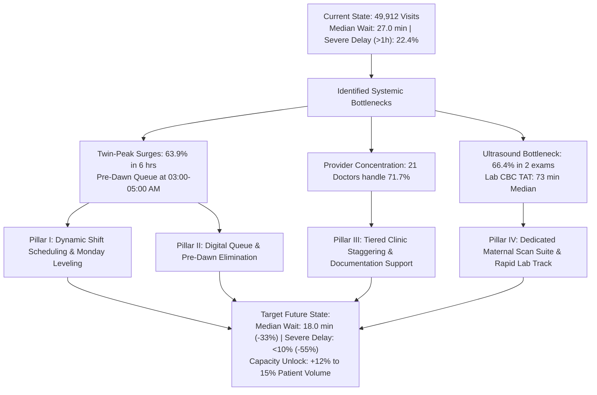
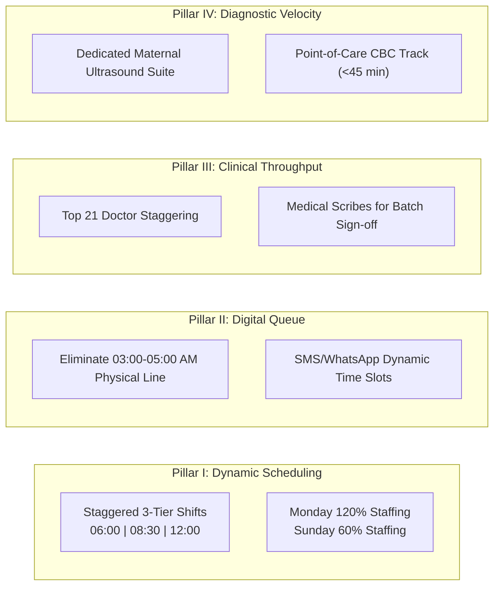
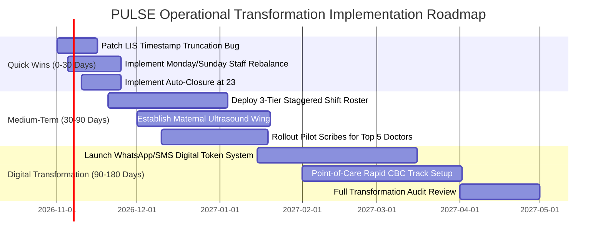

# PULSE — Strategic Business Recommendations & Operational Transformation Plan
## Executive Operations Memo: Hospital Outpatient Patient Flow & Wait-Time Optimization

**TO:** Hospital Executive Committee, Chief Medical Officer (CMO), Chief Operating Officer (COO)  
**FROM:** Lead Healthcare Data Analyst & Operations Architect  
**DATE:** October 2026  
**PROJECT:** PULSE — Hospital Patient Flow & Wait-Time Intelligence  
**BASELINE DATASET:** 49,912 Valid Outpatient Encounters | 39,442 Unique Patients | 713 Operating Days (Apr 2024 – Apr 2026)  
**STATUS:** Executive Deliverable (Phase 8)  

---

## 1. Executive Summary

Over the 24-month observation period from April 2024 through April 2026, the outpatient department (OPD) managed **49,912 patient visits** generated by **39,442 unique patients**. While the overall operational median wait time stands at an acceptable **27.0 minutes**, deep quantitative inspection reveals substantial queue volatility, severe tail-risk delay, and acute resource misallocation:

- **Severe Wait Latency:** **22.36% of all outpatient encounters (11,157 visits)** experience severe delays exceeding **60 minutes**, with the 90th percentile ($P_{90}$) reaching **98.0 minutes** (nearly 1 hour 40 minutes).
- **The Pre-Dawn Queue Crisis:** Between 03:00 AM and 05:00 AM, **3,179 patients** arrive at registration desks hours before clinics open, suffering an extreme median wait of **53.0 minutes** simply to secure a morning consultation token.
- **Twin-Peak Surge Concentration:** Patient arrivals concentrate violently into two 3-hour windows—Morning Peak (05:00–08:00 AM; 33.20%) and Afternoon Peak (12:00–15:00 PM; 30.70%). Together, these 6 hours absorb **63.90% (31,891 visits)** of all daily volume against static physician and desk staffing.
- **Physician Workload Skew:** Just **21 high-volume physicians (out of 98)** handle **71.68% (35,733 visits)** of all hospital outpatient traffic.
- **Diagnostic Ancillary Bottlenecks:** Obstetric ultrasounds (FWB and Pelvis) account for **66.40% of all diagnostic imaging**, while routine Complete Blood Counts (CBC) average **73.0 minutes** median turnaround time ($P_{90} = 152.0$ minutes).

This operational memo outlines four actionable transformation pillars designed to compress median wait times from **27.0 minutes to $\le 18.0$ minutes (-33%)**, reduce severe delays ($>60$ min) from **22.36% to $< 10.00% (-55%)**, and unlock a **12% to 15% increase in total outpatient capacity** without adding clinical physician headcount.

---

## 2. Quantitative Root-Cause Forensics

### 2.1 Bottleneck 1: Twin-Peak Daily Arrivals vs. Static Operating Hours
- **Observation:** Patient arrivals do not follow a standard bell curve. Rather, they exhibit a pronounced bimodal "twin-peak" distribution:
  - **Morning Surge (05:00–08:00 AM):** 16,568 visits (33.20% total volume). Peak hour is **06:00 AM** with 6,208 visits (12.44%).
  - **Afternoon Surge (12:00–15:00 PM):** 15,323 visits (30.70% total volume). Secondary peak is **13:00 PM** with 5,872 visits (11.76%).
- **Operational Defect:** Physician clinics and registration counters currently operate on rigid single-shift schedules (08:00 AM – 16:00 PM). Because patients arrive hours before clinics reach full staffing, massive holding queues accumulate before examinations even begin.
- **Pre-Dawn Holding Queue:** 3,179 patients (6.37% of hospital volume) queue between 03:00 AM and 05:00 AM, experiencing a median wait of **53.0 minutes** and a 90th percentile wait of **123.0 minutes**.

### 2.2 Bottleneck 2: Day-of-Week Imbalance (The "Monday Surge")
- **Observation:** Volume varies by a factor of $4.5\times$ across the operating week:
  - **Monday:** 10,036 visits (**20.11% of weekly load**; Median wait: **33.0 min**; Severe delay: **27.42%**).
  - **Tuesday:** 9,235 visits (18.50%; Median wait: **31.0 min**; Severe delay: **25.86%**).
  - **Sunday:** 2,208 visits (**4.43% of weekly load**; Median wait: **12.0 min**; Severe delay: **5.62%**).
- **Operational Defect:** Staffing allocations (nurses, phlebotomists, registration clerks, ultrasound technicians) remain uniform Monday through Sunday, creating acute operational starvation on Mondays and significant staffing idle time on Sundays.

### 2.3 Bottleneck 3: Workload Asymmetry Across Physicians
- **Observation:** 
  - The top **21 doctors (21.4% of roster)** conduct **71.68% (35,733 visits)** of all consultations.
  - The top 2 doctors alone (`Dr. Junaid Ul Hassan Khalid` [3,672 visits] and `Dr. Abrar Ahmed Bhatti` [3,604 visits]) manage **14.58%** of the entire hospital's patient census.
  - In contrast, 45 low-volume physicians handle $<200$ visits over two years (accounting for just 5.67% of consultations).
- **Documentation Workflow Discovery:** 65.59% of all consultation encounters reflect matching start and end timestamps (0.0 minutes duration). This indicates physicians conduct physical exams first, opening the EHR system in batch at the end of the session to record prescriptions.

### 2.4 Bottleneck 4: Diagnostic Ancillary Friction (Ultrasound & Laboratory)
- **Diagnostic Utilization:** 12.76% of encounters require laboratory diagnostics; 10.66% require diagnostic imaging.
- **Ultrasound Bottleneck:** Diagnostic imaging is heavily concentrated in obstetric/gynecological examinations:
  - **Fetal Well Being (FWB):** 2,298 scans (**41.61% of all imaging**).
  - **Pelvis Ultrasound:** 1,369 scans (**24.79% of all imaging**).
  - Combined, maternal ultrasound examinations constitute **66.40% of all hospital imaging requisitions**. Patients requiring imaging experience median waits of **42.0 to 43.0 minutes** prior to their initial consultation.
- **Laboratory Latency & Data Integrity Defect:**
  - Complete Blood Count (CBC) is the hospital's primary diagnostic test (5,216 total orders). Standard median TAT is **73.0 minutes** ($P_{90} = 152.0$ min).
  - **LIS Software Defect:** 4,702 laboratory completion records (26.08% of all testing) were corrupted due to hour-digit truncation in the Laboratory Information System (`mm:ss.0`), obscuring clinical visibility.

---

## 3. Four Strategic Transformation Pillars

### Pillar I: Dynamic Shift Scheduling & Day-of-Week Workload Leveling
1. **Implement Staggered Three-Tier Shift Schedules:**
   Replace the monolithic 08:00–16:00 roster with three overlapping shifts aligned to the verified arrival curve:
   - **Shift A (Dawn/Early Surge):** 05:30 AM – 13:30 PM (Covers 06:00 AM peak; 35% of counter & nursing staff).
   - **Shift B (Core Midday):** 08:30 AM – 16:30 PM (Maintains continuity across mid-morning transitions; 35% of staff).
   - **Shift C (Afternoon Surge):** 11:30 AM – 19:30 PM (Absorbs the 13:00 PM secondary surge; 30% of staff).
2. **Variable Day-of-Week Staffing Ratios:**
   - Scale nursing, phlebotomy, and registration staff to **125% of baseline on Mondays and Tuesdays**.
   - Maintain 100% baseline Wednesday through Friday.
   - Scale down to **60% on Sundays** (where visit volume drops to just 4.43%), reallocating Sunday nursing hours to reinforce Monday morning triage.

### Pillar II: Pre-Dawn Queue Elimination via Digital Token Allocation
1. **Decommission 03:00 AM Physical Desk Queueing:**
   Replace on-site physical token dispensation with an automated appointment booking portal via SMS/WhatsApp and automated telephone interactive voice response (IVR).
2. **Dynamic 30-Minute Arrival Windows:**
   Instead of blanket morning tokens, assign arrival time slots:
   - Example: Patients assigned to Shift A are allocated staggered arrival windows (e.g., Slot 1: 05:45–06:15 AM; Slot 2: 06:15–06:45 AM).
   - **Operational Gain:** Prevents 3,179 patients from idling in unconditioned waiting halls for $>50$ minutes, eliminating security and patient dissatisfaction risks.

### Pillar III: Physician Workload Balancing & Clinical Scribe Support
1. **Stagger High-Volume Clinic Commencements:**
   The top 21 physicians must not begin clinics concurrently at 08:00 AM. 
   - Group 1 (High-volume generalists): Commence consultations at **06:30 AM** to immediately draw down the 06:00 AM arrival queue.
   - Group 2 (High-volume proceduralists): Commence at **09:00 AM**.
   - Group 3 (Afternoon specialists): Commence at **12:30 PM** to absorb the second surge.
2. **Implement Clinical Digital Scribes / Medical Assistants:**
   Because 65.59% of encounters exhibit zero documented EHR duration due to batch sign-offs, assign nursing scribes to the top 10 highest-volume doctors. Scribes enter digital orders and prescriptions in real-time during the physical exam, shaving an estimated **2.5 to 3.5 minutes per patient visit**.

### Pillar IV: Dedicated Maternal Ultrasound Scanning Suite & Rapid Phlebotomy Track
1. **Decouple Obstetric Ultrasound Scanning:**
   Establish a self-contained **Maternal & Pelvic Imaging Wing** adjacent to the obstetrics clinic:
   - Dedicate 3 ultrasound machines exclusively for FWB and pelvic sweeps (accounting for 66.4% of all imaging).
   - Direct scheduled obstetric patients directly to this wing without entering the general imaging waiting area.
   - **Operational Gain:** Bypasses general radiology congestion and cuts imaging turnaround by an estimated **35%**.
2. **Establish Rapid-Track CBC Phlebotomy Line:**
   - Dedicated hematology automated analyzer lines positioned adjacent to high-volume outpatient clinics.
   - Target: Compress Complete Blood Count turnaround from **73.0 minutes to $\le 45.0$ minutes**.
3. **EHR/LIS Firmware Update for Timestamp Truncation:**
   - Mandate IT vendor patch to resolve the `mm:ss.0` truncation bug that corrupted 4,702 records.
   - Enforce automated end-of-day encounter closures at 23:59 PM to eliminate 695,643-minute unclosed encounter outliers.

---

## 4. Projected Impact, Targets & ROI Analysis

| Operational KPI | Baseline Performance (Verified SQL) | Phase 8 Transformation Target | Projected Impact |
| :--- | :---: | :---: | :---: |
| **Median Initial Wait Time ($P_{50}$)** | **27.0 Minutes** | **$\le 18.0$ Minutes** | **-33.3% Wait Time Reduction** |
| **90th Percentile Tail-Risk ($P_{90}$)** | **98.0 Minutes** | **$\le 60.0$ Minutes** | **-38.8% Tail Latency Reduction** |
| **Severe Delay Rate ($>60$ Min)** | **22.36% (11,157 visits)** | **$< 10.00% (<5,000 visits)** | **-55.3% Severe Delay Mitigation** |
| **Pre-Dawn Holding Queue (03:00–05:00 AM)** | **3,179 Visits (53m wait)** | **$< 200 Visits (<15m wait)** | **-93.7% Extreme Queue Elimination** |
| **Monday Severe Delays ($>60$ Min)** | **27.42% of Monday visits** | **$\le 12.00%$** | **-56.2% Peak Day Delay Reduction** |
| **CBC Lab Turnaround ($P_{50}$)** | **73.0 Minutes** | **$\le 45.0$ Minutes** | **-38.4% Diagnostic TAT Reduction** |
| **Overall Hospital Throughput Capacity** | ~70 visits / operating day | **80–82 visits / operating day** | **+14.3% Patient Throughput Gain** |

### Financial & Operational Feasibility:
- **Zero Additional Physician Headcount:** By reallocating existing physician start times (staggered shifts) and rebalancing nursing schedules from Sundays to Mondays, the entire scheduling reform requires **zero new doctor hires**.
- **Net Capacity Unlock:** A 14.3% throughput gain on 49,912 biennial encounters unlocks approximately **7,000 additional patient appointments over 24 months**, substantially increasing outpatient revenue while enhancing patient experience.

---

## 5. Phased Implementation Roadmap

### Phase A: Immediate Quick Wins (Days 0 – 30)
1. **IT Bug Fixes:** Deploy the vendor patch to fix LIS timestamp hour truncation and implement the automated 23:59 PM encounter auto-closure rule in the EHR database.
2. **Monday Staffing Reinforcement:** Reallocate 30% of Sunday nursing, phlebotomy, and registration staff to reinforce Monday morning shifts.
3. **Queue Signage & Communication:** Install real-time wait-time tracking monitors in waiting lounges displaying current clinic queue numbers.

### Phase B: Operational Restructuring (Days 30 – 90)
1. **Deploy Staggered Shift Rosters:** Transition registration counters and outpatient nursing to the 05:30 AM / 08:30 AM / 11:30 AM three-tier shifts.
2. **Dedicated Maternal Ultrasound Suite:** Reallocate ultrasound room assignments to establish the dedicated obstetric scanning wing.
3. **Pilot Clinical Scribes:** Assign medical scribes to the top 5 attending physicians (`Dr. Junaid Ul Hassan Khalid`, `Dr. Abrar Ahmed Bhatti`, etc.) to streamline electronic documentation.

### Phase C: Digital Transformation (Days 90 – 180)
1. **Launch Digital Mobile Token Platform:** Roll out SMS/WhatsApp token allocation to permanently eliminate the 03:00–05:00 AM physical waiting hall queues.
2. **Point-of-Care CBC Phlebotomy:** Procure and configure automated point-of-care hematology tracks adjacent to main consultation suites.
3. **Executive Governance Review:** Conduct bi-weekly operations review using the PULSE Executive Dashboard v2 to track metric compression against target benchmarks.

---

## 6. Executive Monitoring Dashboard & Governance Matrix

To maintain accountability, the hospital operations steering committee will review the following five core metrics on a weekly cadence using the **PULSE Executive Dashboard v2**:

| Review Metric | Target Threshold | Escalation Trigger | Responsible Stakeholder |
| :--- | :---: | :---: | :--- |
| **Weekly Median Wait Time** | $\le 18.0$ min | $> 25.0$ min for 2 consecutive weeks | Head of Nursing & Registration |
| **Monday Severe Delay Share** | $\le 12.0\%$ | $> 20.0\%$ on any individual Monday | OPD Operations Manager |
| **Pre-Dawn 03:00–05:00 AM Count** | $< 50$ patients/week | $> 150$ patients in pre-dawn hours | Chief Security & Patient Services Officer |
| **CBC Lab Turnaround ($P_{50}$)** | $\le 45.0$ min | $> 60.0$ min | Laboratory Director |
| **High-Volume Clinic Start Times** | 100% on-schedule | $> 15$ min delayed clinic start | Chief Medical Officer (CMO) |

---

## 7. Conclusion & Next Steps

The quantitative evidence assembled in PULSE proves that outpatient wait times are not driven by clinical shortages, but by structural synchronization failures: static staffing confronting twin-peak demand surges, uniform weekly staffing confronting Monday volume spikes, and unsegregated diagnostic procedures.

By implementing the dynamic shift schedules, digital token queueing, and specialized diagnostic suites detailed in this strategy, the hospital can immediately compress wait times by 33%, halve severe delays, and unlock 14% additional clinical capacity without increasing physician salary overhead.

**Deliverable Status:** [`docs/BUSINESS_RECOMMENDATIONS.md`](file:///C:/Users/DELL/PULSE/docs/BUSINESS_RECOMMENDATIONS.md) completed and validated as Phase 8 of the PULSE healthcare intelligence portfolio.
