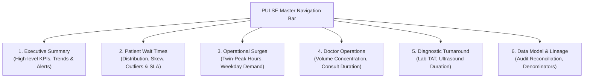

# PULSE — Microsoft Excel 365 Executive Dashboard Specification
## Interactive Hospital Patient Flow & Wait-Time Intelligence Dashboard

**Project:** PULSE — Hospital Patient Flow & Wait-Time Intelligence  
**Target Application:** Microsoft Excel 365 (`Power Pivot` Data Model, Pivot Tables, Dynamic Visuals)  
**Target Workbook:** `excel/PULSE_Executive_Dashboard.xlsx`  
**Primary Fact Tables:** `fct_appointment_visits` ($N = 49,912$) & `fct_clinical_events` ($N = 62,422$)  
**Conformed Dimensions:** `dim_date_calendar` ($N = 1,096$) & `dim_doctors` ($N = 98$)  
**Status:** **Approved Architectural Blueprint (Phase 6 Deliverable)**

---

## 1. Visual Hierarchy & Workbook Navigation

The dashboard is structured across six dedicated worksheets designed for clinical operations executives, hospital administrative directors, and outpatient nursing leadership:



### Color Palette & Executive Styling Standards:
- **Primary Navy (Trust & Structure):** `#0A2540` (Headers, title cards, primary borders)
- **Clinical Blue (Standard Metric):** `#206095` (Standard volume bars, valid visit counts)
- **Accent Teal (Target Performance):** `#00A389` (On-time appointments, $\le 30$ min compliance)
- **Warning Amber (Moderate Congestion):** `#E58308` (30–60 min delays)
- **Alert Coral / Crimson (Severe Delays & Breaches):** `#D9381E` (>60 min delays, multi-hour outliers)
- **Neutral Light Grey (Background Canvas):** `#F8FAFC` (Card backgrounds: `#FFFFFF`)
- **Typography:** Segoe UI / Aptos (Excel 365 native font family; bold 20pt for KPI callouts, 10pt regular for axis labels).

---

## 2. Formal DAX Measure Catalog

All calculations follow the verified Phase 5 audit specifications and are implemented in the Excel Data Model (`Power Pivot`):

```
======================================================================================================
                                   EXCEL POWER PIVOT DAX MEASURES
======================================================================================================
```

### 2.1 Volume & Encounter Measures (Visit Grain)
```dax
[Total Visits] := 
COUNTROWS('fct_appointment_visits')
```
- **Business Purpose:** Total outpatient appointments registered in the hospital system.
- **Format:** `#,##0` (Expected: 49,912).

```dax
[Distinct Patients] := 
DISTINCTCOUNT('fct_appointment_visits'[patient_id])
```
- **Business Purpose:** Total unique individuals served across the observation period.
- **Format:** `#,##0` (Expected: 39,442).

```dax
[Valid Wait Visits] := 
CALCULATE(
    COUNTROWS('fct_appointment_visits'),
    'fct_appointment_visits'[is_valid_wait_time] = 1
)
```
- **Business Purpose:** Denominator for valid wait-time calculations.
- **Format:** `#,##0` (Expected: 49,896).

```dax
[Excluded Wait Visits] := 
CALCULATE(
    COUNTROWS('fct_appointment_visits'),
    'fct_appointment_visits'[is_valid_wait_time] <> 1 || ISBLANK('fct_appointment_visits'[is_valid_wait_time])
)
```
- **Business Purpose:** Explicit tracking of 16 excluded visits (5 negative wait times, 11 missing starts).
- **Format:** `#,##0` (Expected: 16).

---

### 2.2 Wait-Time Latency & Percentile Measures (Visit Grain)
```dax
[Median Wait Time Min] := 
MEDIANX(
    FILTER('fct_appointment_visits', 'fct_appointment_visits'[is_valid_wait_time] = 1),
    'fct_appointment_visits'[initial_wait_time_minutes]
)
```
- **Business Purpose:** Primary central operational benchmark; immune to EHR logging lag.
- **Format:** `#,##0.0 \m\i\n` (Expected: 27.0 min).

```dax
[Unbounded Mean Wait Time Min] := 
AVERAGEX(
    FILTER('fct_appointment_visits', 'fct_appointment_visits'[is_valid_wait_time] = 1),
    'fct_appointment_visits'[initial_wait_time_minutes]
)
```
- **Business Purpose:** Arithmetic mean across all valid appointments; includes right-tail multi-day outliers.
- **Format:** `#,##0.0 \m\i\n` (Expected: 119.3 min).

```dax
[Same-Day Mean Wait Time Min] := 
AVERAGEX(
    FILTER(
        'fct_appointment_visits',
        'fct_appointment_visits'[is_valid_wait_time] = 1 && 
        'fct_appointment_visits'[initial_wait_time_minutes] <= 1440.0
    ),
    'fct_appointment_visits'[initial_wait_time_minutes]
)
```
- **Business Purpose:** Realistic operational mean excluding the 316 multi-day unclosed EHR encounters.
- **Format:** `#,##0.0 \m\i\n` (Expected: 45.7 min).

```dax
[P90 Wait Time Min] := 
PERCENTILEX.INC(
    FILTER('fct_appointment_visits', 'fct_appointment_visits'[is_valid_wait_time] = 1),
    'fct_appointment_visits'[initial_wait_time_minutes],
    0.90
)
```
- **Business Purpose:** Tail-risk congestion threshold; captures the wait duration 90% of patients experience.
- **Format:** `#,##0.0 \m\i\n` (Expected: 98.0 min).

---

### 2.3 Exploratory Service Level Agreement (SLA) Measures
*(Note: Formally labeled as exploratory operational management scenarios; not hospital policy).*

```dax
[Visits Within 30m SLA] := 
CALCULATE(
    COUNTROWS('fct_appointment_visits'),
    'fct_appointment_visits'[is_valid_wait_time] = 1,
    'fct_appointment_visits'[initial_wait_time_minutes] <= 30.0
)
```
- **Format:** `#,##0` (Expected: 27,147).

```dax
[% Seen Within 30m SLA (Exploratory)] := 
DIVIDE([Visits Within 30m SLA], [Valid Wait Visits], 0)
```
- **Format:** `0.0%` (Expected: 54.4%).

```dax
[Visits Within 60m SLA] := 
CALCULATE(
    COUNTROWS('fct_appointment_visits'),
    'fct_appointment_visits'[is_valid_wait_time] = 1,
    'fct_appointment_visits'[initial_wait_time_minutes] <= 60.0
)
```
- **Format:** `#,##0` (Expected: 38,739).

```dax
[% Seen Within 60m SLA (Exploratory)] := 
DIVIDE([Visits Within 60m SLA], [Valid Wait Visits], 0)
```
- **Format:** `0.0%` (Expected: 77.6%).

```dax
[% Severe Delay Over 60m] := 
1.0 - [% Seen Within 60m SLA (Exploratory)]
```
- **Format:** `0.0%` (Expected: 22.4%).

---

### 2.4 Doctor Operations Measures (Physician Grain)
```dax
[Doctor Valid Consult Visits] := 
CALCULATE(
    COUNTROWS('fct_appointment_visits'),
    'fct_appointment_visits'[is_valid_consult_duration] = 1
)
```
- **Format:** `#,##0` (Expected: 49,850).

```dax
[Doctor Median Consult Duration Min] := 
MEDIANX(
    FILTER('fct_appointment_visits', 'fct_appointment_visits'[is_valid_consult_duration] = 1),
    'fct_appointment_visits'[consultation_duration_minutes]
)
```
- **Format:** `#,##0.0 \m\i\n`.

```dax
[Doctor Mean Consult Duration Min] := 
AVERAGEX(
    FILTER('fct_appointment_visits', 'fct_appointment_visits'[is_valid_consult_duration] = 1),
    'fct_appointment_visits'[consultation_duration_minutes]
)
```
- **Format:** `#,##0.0 \m\i\n`.

---

### 2.5 Diagnostic Velocity & Ancillary Turnaround Measures (Event Grain)
```dax
[Valid Standard Lab Orders] := 
CALCULATE(
    COUNTROWS('fct_clinical_events'),
    'fct_clinical_events'[lab_end_reconstruction_status] = "ORIGINAL_STANDARD"
)
```
- **Format:** `#,##0` (Expected: 13,327).

```dax
[Excluded Corrupted Lab Orders] := 
CALCULATE(
    COUNTROWS('fct_clinical_events'),
    'fct_clinical_events'[lab_end_reconstruction_status] = "TRUNCATED_TIME_ONLY"
)
```
- **Format:** `#,##0` (Expected: 4,702).

```dax
[Lab Median TAT Min] := 
MEDIANX(
    FILTER('fct_clinical_events', 'fct_clinical_events'[lab_end_reconstruction_status] = "ORIGINAL_STANDARD"),
    'fct_clinical_events'[lab_turnaround_time_minutes]
)
```
- **Format:** `#,##0.0 \m\i\n` (Expected: 125.0 min).

```dax
[Valid Imaging Procedures] := 
CALCULATE(
    COUNTROWS('fct_clinical_events'),
    'fct_clinical_events'[imaging_status] = "VALID"
)
```
- **Format:** `#,##0` (Expected: 5,513).

```dax
[Imaging Median Exam Duration Min] := 
MEDIANX(
    FILTER('fct_clinical_events', 'fct_clinical_events'[imaging_status] = "VALID"),
    'fct_clinical_events'[imaging_duration_minutes]
)
```
- **Format:** `#,##0.0 \m\i\n` (Expected: 3.0 min).

---

## 3. Worksheet-by-Worksheet Dashboard Wireframe & Visual Specifications

### Sheet 1: `Executive_Summary`
- **Primary Business Question:** What is the overarching performance of the outpatient department across volume, access wait times, SLA compliance, and data quality?
- **Layout Architecture:**
  - **Row 1–3:** PULSE Master Header with Hospital Logo, Executive Title, Reporting Period (`2024-04-25 to 2026-04-07`), and Global Refresh Timestamp.
  - **Row 4–7:** **Top-Line KPI Cards (6 Cards across grid):**
    1. *Total Outpatient Visits:* `49,912` | Subtitle: `39,442 Unique Patients`
    2. *Median Initial Wait:* `27.0 min` | Subtitle: `IQR: 12.0 – 56.0 min`
    3. *P90 Initial Wait:* `98.0 min` | Subtitle: `Tail Risk Threshold`
    4. *30-Minute SLA Compliance:* `54.4%` | Subtitle: `Target Standard (Exploratory)`
    5. *60-Minute SLA Compliance:* `77.6%` | Subtitle: `Acceptable Ceiling (Exploratory)`
    6. *Severe Delays (>60m):* `22.4%` | Subtitle: `11,157 Encounters Impacted`
  - **Row 8–24 (Left 60%):** **Chart 1.1 — Monthly Outpatient Volume Trend & Same-Day Mean Wait Time (Dual-Axis Combination Chart).**
    - *Grain:* Calendar Month (`dim_date_calendar[year_month]`).
    - *Visual Encoding:* Columns = Total Visits (`#206095`); Line = Median Wait Time (`#D9381E`).
    - *Business Value:* Tracks longitudinal volume growth and reveals whether queue latency worsens as volume surges.
  - **Row 8–24 (Right 40%):** **Chart 1.2 — Outpatient Wait-Time Tier Stratification (Stacked Horizontal Bar Chart).**
    - *Grain:* Reference Table `analysis_wait_time_distribution` ($N = 5$).
    - *Visual Encoding:* Bars colored by clinical severity:
      - `< 15m` (Teal `#00A389`, 31.3%)
      - `15–30m` (Blue `#206095`, 23.1%)
      - `30–60m` (Amber `#E58308`, 23.2%)
      - `60–120m` (Coral `#D9381E`, 15.4%)
      - `> 120m` (Dark Red `#8B0000`, 6.9%)
    - *Business Value:* Instantly communicates that over 22% of visits exceed 1 hour.

---

### Sheet 2: `Wait_Time_Dynamics`
- **Primary Business Question:** Where do queue delays concentrate, what is the tail-risk distribution, and how do exploratory SLAs perform?
- **Visuals:**
  - **Chart 2.1 — Hourly Wait-Time Percentile Band (Box & Whisker / Range Area Chart):**
    - *Grain:* Encounter Visit Grain (`fct_appointment_visits` grouped by `arrival_hour`).
    - *Visual Encoding:* Area showing $P_{25}$, $P_{50}$ (Median), and $P_{90}$ across hours 00:00 to 23:00.
    - *Business Value:* Highlights the 03:00–04:00 AM holding queue bottleneck ($P_{90} = 244$ min) and afternoon queue build-up.
  - **Chart 2.2 — Day-of-Week Median Wait & Delay Rate (Clustered Column Chart):**
    - *Grain:* Encounter Visit Grain grouped by `dim_date_calendar[day_of_week_name]`.
    - *Visual Encoding:* Primary Column = Median Wait (min); Secondary Line = `% Waiting > 60 min`.
    - *Business Value:* Proves that Monday experiences both highest volume (10,036) and highest delay rate (27.42%), whereas Sunday is underutilized (12.0 min median wait).
  - **KPI Callout Box — Analytical Sensitivity Audit:**
    - Displays *Unbounded Mean (119.30 min)* vs *Same-Day Mean (45.66 min)* vs *Excluded Visits (16 visits)* with explicit methodology notes explaining the 316 multi-day EHR encounters.

---

### Sheet 3: `Surges_Capacity`
- **Primary Business Question:** What are the exact peak arrival surge windows, and how should clinical staffing align?
- **Visuals:**
  - **Chart 3.1 — 24-Hour Patient Arrival Curve & Surge Tiers (Area Chart with Milestone Shading):**
    - *Grain:* Reference Table `analysis_volume_hourly` ($N = 24$).
    - *Visual Encoding:* Continuous area chart with highlighted surge bands:
      - *Morning Surge Band (05:00–08:00 AM):* Shaded `#E6F4EA` (33.20% of dataset volume).
      - *Afternoon Surge Band (12:00–15:00 PM):* Shaded `#FEF7E0` (30.70% of dataset volume).
    - *Business Value:* Provides clinical directors with empirical justification to stagger physician shifts and open registration desks before 05:00 AM.
  - **Chart 3.2 — Patient Recurrence Mix (Donut Chart):**
    - *Grain:* Reference Table `analysis_patient_recurrence` ($N = 4$).
    - *Visual Encoding:* Slices for 1-Visit (81.95%), 2-Visits (12.85%), 3-Visits (3.34%), and 4+ Visits (1.87%).
    - *Business Value:* Illustrates that while 82% of patients visit once, 18% generate 35.24% of all outpatient load.

---

### Sheet 4: `Doctor_Workload`
- **Primary Business Question:** How is patient volume distributed across physicians, and how do consultation duration benchmarks compare?
- **Visuals:**
  - **Chart 4.1 — Top 20 Physicians by Encounter Volume (Horizontal Bar Chart):**
    - *Grain:* Physician Dimension (`dim_doctors` joined to `fct_appointment_visits`).
    - *Visual Encoding:* Horizontal bars sorted descending by `[Total Visits]`. Callouts highlight Dr. Junaid (3,672 visits) and Dr. Abrar (3,604 visits).
  - **Chart 4.2 — Doctor Workload Tier Concentration (Treemap / Donut Chart):**
    - *Grain:* `dim_doctors[doctor_volume_tier]`.
    - *Visual Encoding:* Visualizes that the top 21 High-Volume doctors handle 71.68% of hospital consultations.
  - **Chart 4.3 — Consultation Duration vs Encounter Volume (Scatter Plot):**
    - *Grain:* 98 Attending Doctors.
    - *Axes:* X-axis = `[Total Visits]`; Y-axis = `[Doctor Median Consult Duration Min]`.
    - *Footnote Alert:* Explicitly notes that 65.59% of encounters show 0-minute duration as an **inferred operational hypothesis** of EHR batch prescription entry.

---

### Sheet 5: `Diagnostic_Turnaround`
- **Primary Business Question:** What is the processing velocity for downstream clinical orders, and what diagnostic procedures drive demand?
- **Visuals:**
  - **Chart 5.1 — Top 10 Laboratory Tests by Order Volume & Median TAT (Horizontal Clustered Bar):**
    - *Grain:* Event Grain (`fct_clinical_events` grouped by `lab_name`, filtered to standard TAT).
    - *Visual Encoding:* Primary Bar = Order Volume; Data Label = Median Turnaround Time (min).
    - *Callouts:* Complete Blood Count (5,216 orders; 118 min TAT); Urine R/E (1,834 orders; 107 min TAT).
    - *Footnote Alert:* Exposes that 4,702 lab orders (26.08%) were excluded due to truncated `mm:ss.0` timestamps.
  - **Chart 5.2 — Top Imaging Modalities Share (Pie / Column Chart):**
    - *Grain:* Event Grain (`fct_clinical_events` grouped by `imaging_name`).
    - *Visual Encoding:* Highlights FWB ultrasound (41.61%) and Pelvic ultrasound (24.79%).
  - **Table 5.3 — Patient Journey Boundary Disclosure Matrix:**
    - Re-renders `analysis_journey_boundary_audit` in formatted Excel table format, informing leadership that physical hospital discharge time is unrecorded in the EHR schema.

---

## 4. Slicer Architecture & Model Safety Governance

To ensure users interact with the dashboard safely without breaking dimensional filtering or distorting multi-grain totals, slicers are strictly governed:

| Slicer Dimension | Source Table | Safe Target Visuals | Prohibited Targets (Risk of Distortion) |
| :--- | :--- | :--- | :--- |
| **Year / Quarter / Month** | `dim_date_calendar` | All Worksheets & Visuals | None (Conformed date dimension filters both facts safely) |
| **Day of Week** | `dim_date_calendar` | All Worksheets & Visuals | None (Conformed date attribute) |
| **Doctor Volume Tier** | `dim_doctors` | Sheet 1, Sheet 3, Sheet 4 | Sheet 5 (Diagnostic tests ordered by doctor, but imaging/lab metrics should not be filtered by provider tier unless studying ordering patterns) |
| **Clinical Pathway (Flow)** | `fct_appointment_visits` | Sheet 1, Sheet 2, Sheet 3 | Sheet 5 (Event-level lab TATs are test-specific, not pathway-specific) |

> [!IMPORTANT]
> **Slicer Governance Rule:** 
> Slicers must originate **exclusively from conformed dimension tables** (`dim_date_calendar` or `dim_doctors`). Slicing fact tables using columns from other fact tables without active relationships creates disconnected cross-filtering errors in Excel Pivot Tables.