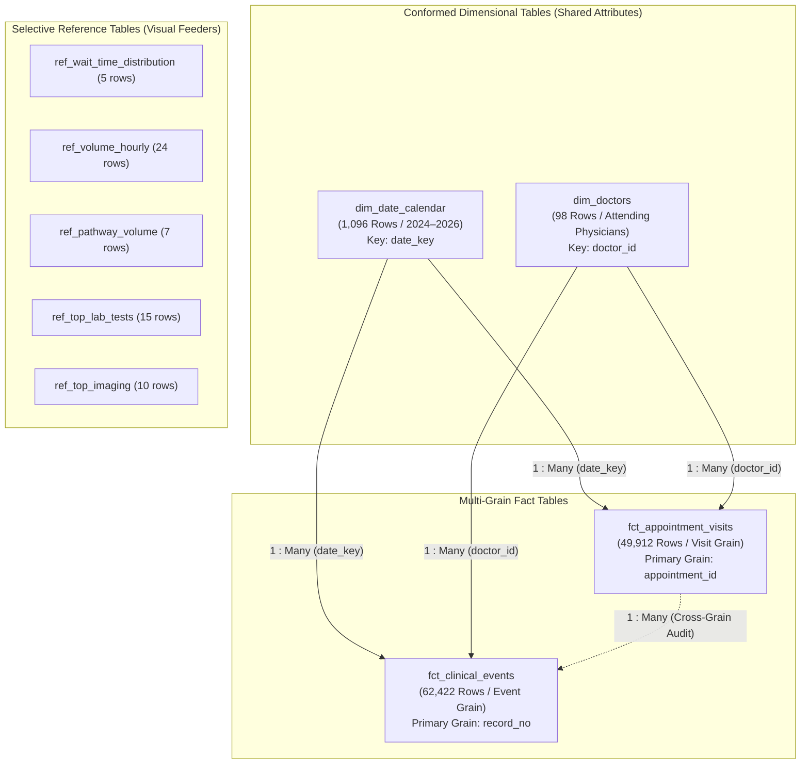

# PULSE — Microsoft Excel 365 & Power Query Ingestion Guide
## Dimensional Data Model Integration & ETL Specification

**Project:** PULSE — Hospital Patient Flow & Wait-Time Intelligence  
**Author:** Lead Data Analyst, Excel 365 Specialist & Project Architect  
**Tools:** Microsoft Excel 365, Power Query (M-Engine), Excel Data Model (`Power Pivot`)  
**Data Sources:** Standardized CSV models in [`data/processed/`](file:///c:/Users/DELL/PULSE/data/processed/)  
**Environment Disclosure:** *In this automated terminal environment, the interactive Microsoft Excel desktop GUI cannot be opened directly. This document provides tested, production-grade Power Query M-code and exact step-by-step instructions for immediate execution in Excel 365.*

---

## 1. Architectural Strategy & Table Ingestion Plan

To prevent model bloat and avoid the confusion of importing all 24 Phase 5 summary tables into Excel, the PULSE dashboard utilizes a **Hybrid Dimensional Architecture**:



### Table Roles & Source File Mapping:
1. **`fct_appointment_visits`** (`data/processed/fct_appointment_visits.csv`):
   - **Grain:** 1 row per outpatient appointment encounter ($N = 49,912$).
   - **Role:** Primary fact table for patient volume, arrival curves, queue wait times, doctor workload, and SLA compliance.
2. **`fct_clinical_events`** (`data/processed/fct_clinical_events.csv`):
   - **Grain:** 1 row per clinical event / ordered service ($N = 62,422$).
   - **Role:** Fact table for diagnostic service volumes, laboratory turnaround times (TAT), and radiological imaging procedures.
3. **`dim_doctors`** (`data/processed/dim_doctors.csv`):
   - **Grain:** 1 row per attending doctor ($N = 98$).
   - **Role:** Conformed dimension for physician profiling, department categorization, and provider volume ranking.
4. **`dim_date_calendar`** (`data/processed/dim_date_calendar.csv`):
   - **Grain:** 1 row per calendar day ($N = 1,096$ days covering 2024-01-01 to 2026-12-31).
   - **Role:** Conformed date dimension for time-intelligence, longitudinal trends, day-of-week analysis, and date slicers.
5. **Selective Aggregate Reference Tables** (`data/processed/analysis/`):
   - Ingested directly into dedicated summary worksheets to power high-speed dashboard visual components without requiring complex multi-tiered DAX measures.

---

## 2. Ingestion Settings & Locale Governance

> [!IMPORTANT]
> **Locale Conversion Rule (Critical):**
> Datetime values in the processed CSVs originate from US format (`YYYY-MM-DD HH:MM:SS` or `M/d/yyyy H:mm`). When importing into Excel 365 on systems configured with UK, European, or International regional settings (`DD/MM/YYYY`), using the default automatic type conversion can transpose months and days or trigger `#ERROR!` values.
> In Power Query, always use **"Using Locale..."** set to **`English (United States)`** for date and datetime columns.

---

## 3. Production Power Query M-Code Scripts

Below is the verified M-code for each table. To use in Excel 365:
1. Open Excel 365 $\rightarrow$ **Data** tab $\rightarrow$ **Get Data** $\rightarrow$ **From Other Sources** $\rightarrow$ **Blank Query**.
2. Click **Advanced Editor** in the Power Query ribbon.
3. Paste the M-code block and click **Done**.
4. In the Home ribbon, click **Close & Load To...** $\rightarrow$ Select **"Only Create Connection"** AND check **"Add this data to the Data Model"**.

### 3.1 `fct_appointment_visits` (Encounter Grain)
```powerquery
let
    // 1. Source Path: Update to your local PULSE directory if different
    SourcePath = "C:\Users\DELL\PULSE\data\processed\fct_appointment_visits.csv",
    
    // 2. Load CSV with UTF-8 encoding and comma delimiter
    Source = Csv.Document(File.Contents(SourcePath), [Delimiter=",", Columns=23, Encoding=65001, QuoteStyle=QuoteStyle.Csv]),
    
    // 3. Promote first row as column headers
    PromotedHeaders = Table.PromoteHeaders(Source, [PromoteAllScalars=true]),
    
    // 4. Enforce strict data types with US locale for datetime fields
    TypedColumns = Table.TransformColumnTypes(PromotedHeaders, {
        {"appointment_id", Int64.Type},
        {"patient_id", Int64.Type},
        {"attending_doctor_id", Int64.Type},
        {"attending_doctor_name", type text},
        {"total_event_records", Int64.Type},
        {"visit_flow_code", Int64.Type},
        {"visit_flow_name", type text},
        {"has_lab", Int64.Type},
        {"total_lab_orders", Int64.Type},
        {"has_imaging", Int64.Type},
        {"total_imaging_requests", Int64.Type},
        {"has_pharmacy", Int64.Type},
        {"total_pharmacy_lines", Int64.Type},
        {"appointment_start_datetime", type datetime},
        {"first_prescription_start_datetime", type datetime},
        {"last_prescription_end_datetime", type datetime},
        {"initial_wait_time_minutes", type number},
        {"is_valid_wait_time", Int64.Type},
        {"consultation_duration_minutes", type number},
        {"is_valid_consult_duration", Int64.Type},
        {"appointment_date", type date},
        {"arrival_hour", Int64.Type},
        {"arrival_day_of_week", type text}
    }, "en-US"),
    
    // 5. Add Operational Same-Day Wait Filter Flag (<= 1,440 min)
    AddedSameDayFlag = Table.AddColumn(TypedColumns, "is_same_day_wait", each 
        if [is_valid_wait_time] = 1 and [initial_wait_time_minutes] <= 1440.0 then 1 else 0, Int64.Type),
        
    // 6. Add Exploratory SLA 30m and 60m Flags
    AddedSLA30Flag = Table.AddColumn(AddedSameDayFlag, "is_within_30m_sla", each 
        if [is_valid_wait_time] = 1 and [initial_wait_time_minutes] <= 30.0 then 1 else 0, Int64.Type),
    AddedSLA60Flag = Table.AddColumn(AddedSLA30Flag, "is_within_60m_sla", each 
        if [is_valid_wait_time] = 1 and [initial_wait_time_minutes] <= 60.0 then 1 else 0, Int64.Type)
in
    AddedSLA60Flag
```

---

### 3.2 `fct_clinical_events` (Event / Order Grain)
```powerquery
let
    // 1. Source Path
    SourcePath = "C:\Users\DELL\PULSE\data\processed\fct_clinical_events.csv",
    
    // 2. Ingest CSV with 52 columns
    Source = Csv.Document(File.Contents(SourcePath), [Delimiter=",", Encoding=65001, QuoteStyle=QuoteStyle.Csv]),
    PromotedHeaders = Table.PromoteHeaders(Source, [PromoteAllScalars=true]),
    
    // 3. Transform critical operational columns with explicit data types
    TypedColumns = Table.TransformColumnTypes(PromotedHeaders, {
        {"record_no", Int64.Type},
        {"patient_id", Int64.Type},
        {"appointment_id", Int64.Type},
        {"prescription_doctor_id", Int64.Type},
        {"prescription_doctor_name", type text},
        {"prescription_order_id", Int64.Type},
        {"lab_id", type text},
        {"lab_name", type text},
        {"imaging_request_id", type text},
        {"imaging_result_id", type text},
        {"imaging_name", type text},
        {"pharmacy_sale_line_id", type text},
        {"medicine_name", type text},
        {"flow_code", Int64.Type},
        {"flow_name", type text},
        {"appointment_start_datetime", type datetime},
        {"prescription_start_datetime", type datetime},
        {"prescription_end_datetime", type datetime},
        {"lab_start_datetime", type datetime},
        {"lab_end_datetime", type datetime},
        {"imaging_start_datetime", type datetime},
        {"imaging_end_datetime", type datetime},
        {"pharmacy_start_datetime", type datetime},
        {"pharmacy_end_datetime", type datetime},
        {"wait_time_minutes", type number},
        {"is_valid_wait_time", Int64.Type},
        {"wait_time_status", type text},
        {"consultation_duration_minutes", type number},
        {"is_valid_consult_duration", Int64.Type},
        {"consult_duration_status", type text},
        {"lab_end_reconstruction_status", type text},
        {"lab_turnaround_time_minutes", type number},
        {"imaging_status", type text},
        {"imaging_duration_minutes", type number},
        {"appointment_date", type date},
        {"arrival_year", Int64.Type},
        {"arrival_hour", Int64.Type},
        {"arrival_day_of_week", type text}
    }, "en-US")
in
    TypedColumns
```

---

### 3.3 `dim_doctors` (Physician Dimension)
```powerquery
let
    // 1. Source Path
    SourcePath = "C:\Users\DELL\PULSE\data\processed\dim_doctors.csv",
    
    // 2. Ingest CSV with 11 columns
    Source = Csv.Document(File.Contents(SourcePath), [Delimiter=",", Encoding=65001, QuoteStyle=QuoteStyle.Csv]),
    PromotedHeaders = Table.PromoteHeaders(Source, [PromoteAllScalars=true]),
    
    // 3. Enforce types
    TypedColumns = Table.TransformColumnTypes(PromotedHeaders, {
        {"doctor_id", Int64.Type},
        {"doctor_name", type text},
        {"total_visits_handled", Int64.Type},
        {"total_events_generated", Int64.Type},
        {"first_consultation_datetime", type datetime},
        {"last_consultation_datetime", type datetime},
        {"valid_consultation_count", Int64.Type},
        {"excluded_consultation_count", Int64.Type},
        {"mean_consultation_duration_minutes", type number},
        {"min_consultation_duration_minutes", type number},
        {"max_consultation_duration_minutes", type number}
    }, "en-US"),
    
    // 4. Add Doctor Volume Tier Categorization
    AddedVolumeTier = Table.AddColumn(TypedColumns, "doctor_volume_tier", each 
        if [total_visits_handled] >= 1000 then "1. High Volume (>=1,000)"
        else if [total_visits_handled] >= 250 then "2. Medium Volume (250-999)"
        else if [total_visits_handled] >= 30 then "3. Low Volume (30-249)"
        else "4. Sparse (<30)", type text)
in
    AddedVolumeTier
```

---

### 3.4 `dim_date_calendar` (Conformed Calendar Dimension)
```powerquery
let
    // 1. Source Path
    SourcePath = "C:\Users\DELL\PULSE\data\processed\dim_date_calendar.csv",
    
    // 2. Ingest CSV with 17 columns
    Source = Csv.Document(File.Contents(SourcePath), [Delimiter=",", Encoding=65001, QuoteStyle=QuoteStyle.Csv]),
    PromotedHeaders = Table.PromoteHeaders(Source, [PromoteAllScalars=true]),
    
    // 3. Enforce types
    TypedColumns = Table.TransformColumnTypes(PromotedHeaders, {
        {"date_key", type date},
        {"date_int", Int64.Type},
        {"full_date", type date},
        {"year", Int64.Type},
        {"quarter", type text},
        {"year_quarter", type text},
        {"month_number", Int64.Type},
        {"month_name", type text},
        {"month_short", type text},
        {"year_month", type text},
        {"day_of_month", Int64.Type},
        {"day_of_week_number", Int64.Type},
        {"day_of_week_name", type text},
        {"day_of_week_short", type text},
        {"is_weekend", Int64.Type},
        {"is_weekday", Int64.Type},
        {"has_hospital_appointments", Int64.Type}
    }, "en-US")
in
    TypedColumns
```

---

## 4. Configuring Relationships in Excel Data Model (`Power Pivot`)

After loading the queries into the Data Model:
1. Open Excel 365 $\rightarrow$ **Power Pivot** tab $\rightarrow$ **Manage**.
2. Switch to **Diagram View** in the Power Pivot window.
3. Establish the following **One-to-Many ($1 : *$)** relationships:

| From Table (Dimension: 1) | Key Column | To Table (Fact: Many) | Foreign Key Column | Filter Direction |
| :--- | :--- | :--- | :--- | :--- |
| `dim_date_calendar` | `date_key` | `fct_appointment_visits` | `appointment_date` | Single (Dimension $\rightarrow$ Fact) |
| `dim_date_calendar` | `date_key` | `fct_clinical_events` | `appointment_date` | Single (Dimension $\rightarrow$ Fact) |
| `dim_doctors` | `doctor_id` | `fct_appointment_visits` | `attending_doctor_id` | Single (Dimension $\rightarrow$ Fact) |
| `dim_doctors` | `doctor_id` | `fct_clinical_events` | `prescription_doctor_id` | Single (Dimension $\rightarrow$ Fact) |

> [!CAUTION]
> **Cross-Grain Relationship Warning:**
> Do NOT create an active direct relationship between `fct_appointment_visits[appointment_id]` and `fct_clinical_events[appointment_id]` inside Power Pivot. 
> Because an appointment can generate up to 28 clinical events, creating a direct active relationship creates ambiguity and risks multi-counting patient visits. Keep both fact tables connected strictly through the conformed dimensions (`dim_date_calendar` and `dim_doctors`).

---

## 5. Automated Refresh Instructions

To update the Excel 365 dashboard when backend data changes:
1. Navigate to the **Data** tab in the Excel ribbon.
2. Click **Refresh All** (or keyboard shortcut `Ctrl + Alt + F5`).
3. Power Query re-reads the CSV files in `data/processed/`, applies all schema transformations, reloads the Data Model, and updates all connected Pivot Tables and KPI cards instantly.