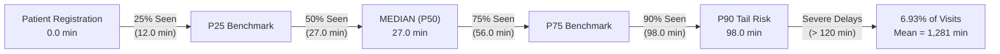
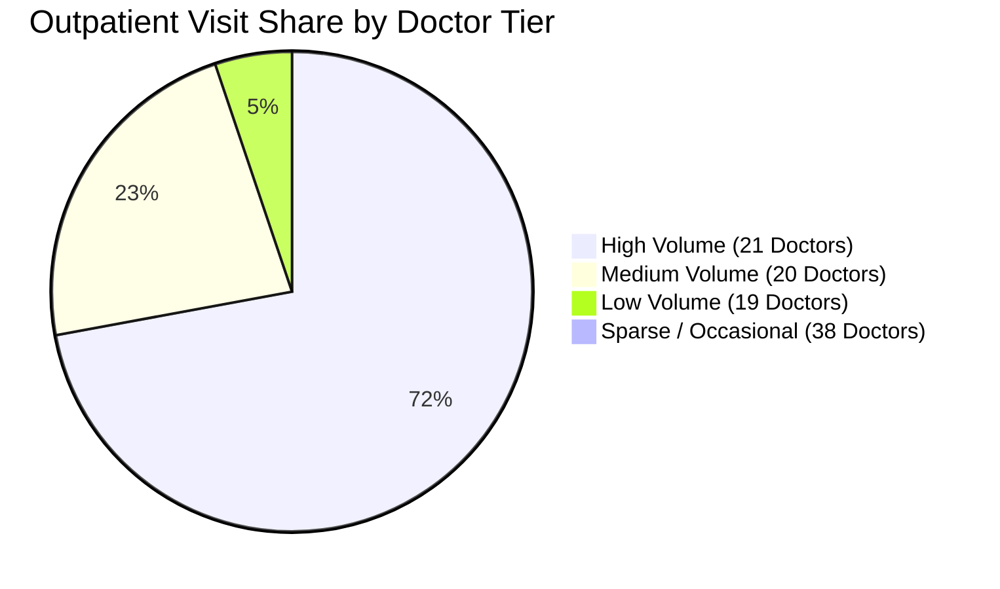
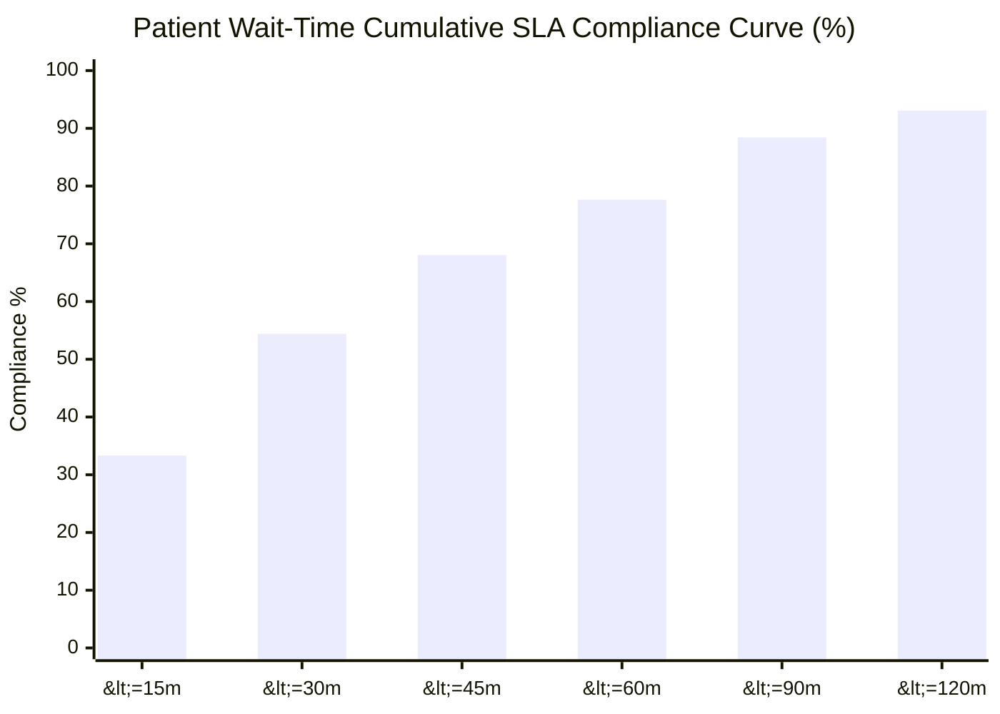
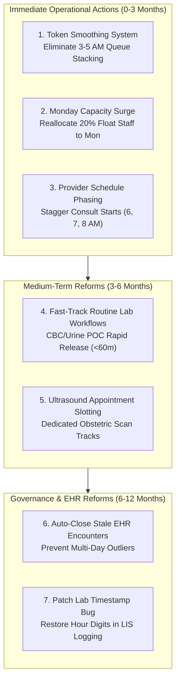

# PULSE — Hospital Patient Flow & Wait-Time Intelligence
## Phase 5: Comprehensive SQL Analytics & Operational Intelligence Report

**Project:** PULSE — Hospital Patient Flow & Wait-Time Intelligence  
**Author:** Lead Data Analyst, SQL Architect & Healthcare Analytics Specialist  
**Target Environment:** SQLite 3.51+ (`data/processed/pulse.db`) & Microsoft Excel 365  
**Data Grain:** Appointment Visit Grain (`fct_appointment_visits`, $N = 49,912$) & Clinical Event Grain (`fct_clinical_events`, $N = 62,422$)  
**Status:** **Complete & Validated (100% Reconciliation Parity across 9 Integrity Tests)**  

---

## Executive Summary

This report delivers an in-depth operational evaluation of the Outpatient Department (OPD) patient journey, provider throughput, and ancillary turnaround times derived from 49,912 clinical visits and 62,422 clinical event records. 

Through rigorous multi-grain dimensional modeling and ANSI SQL analytics, this study uncovers critical operational bottlenecks, quantifies access latency, evaluates provider workload distribution, and establishes data-driven benchmarks for hospital capacity planning.

```
========================================================================================
                               EXECUTIVE KPI SCORECARD
========================================================================================
Metric Scope                       Observed Metric       Analytical Interpretation
----------------------------------------------------------------------------------------
Total Outpatient Visits            49,912 Encounters     Total volume processed (100% tracked)
Distinct Patients Seen             39,442 Patients       81.95% single visit; 18.05% returning
Median Initial Wait Time (P50)     27.0 Minutes          Primary operational benchmark
Mean Initial Wait Time             119.30 Minutes        Distorted by extreme right-tail EHR lag
90th-Percentile Wait Time (P90)    98.0 Minutes          10% of patients wait over 1 hr 38 min
SLA Compliance (<= 30 Min Target)  54.41% of Visits      Only 1 in 2 patients meet 30-min goal
SLA Compliance (<= 60 Min Target)  77.64% of Visits      1 in 4 patients wait over 1 hour
Peak Operating Demand Windows      05:00 - 08:00 AM      Morning Surge: 33.20% of dataset volume
                                   12:00 - 15:00 PM      Afternoon Surge: 30.70% of dataset volume
Heaviest Operational Day           Monday (10,036 visits) 20.1% of weekly load; Median Wait: 33 min
Physician Load Concentration       Top 21 of 98 Doctors  Handle 71.68% of all consultations
Diagnostic Laboratory Median TAT   125.0 Minutes (~2.1h) Standard complete orders (N = 13,327)
Diagnostic Imaging Median Exam     3.0 Minutes           Radiological scanning time (N = 5,513)
========================================================================================
```

---

## 1. Patient Access & Wait-Time Dynamics

### 1.1 Overall Wait-Time Distribution & Non-Normal Skewness
Initial patient wait time is defined as the elapsed time in minutes from official reception/desk registration (`appointment_start_datetime`) to the initiation of the physician consultation (`first_prescription_start_datetime`).

Across 49,896 valid appointments (16 excluded: 5 invalid negative timestamps and 11 missing consultation starts), outpatient wait times exhibit extreme positive (right-tail) skewness:
- **Median Wait Time ($P_{50}$):** **27.0 minutes**
- **Interquartile Range ($IQR$):** **$P_{25} = 12.0$ minutes**, **$P_{75} = 56.0$ minutes** ($IQR = 44.0$ minutes)
- **90th Percentile ($P_{90}$):** **98.0 minutes**
- **95th Percentile ($P_{95}$):** **148.0 minutes**
- **Mathematical Mean:** **119.30 minutes**
- **Maximum Recorded Duration:** **695,643.0 minutes** (~1.3 years; reflective of open EHR encounters never formally terminated in software).



> [!IMPORTANT]
> **Executive Reporting Principle:** The mathematical mean (119.30 min) is severely elevated by long-tail EHR logging delays and unclosed records. The **Median (27.0 min)** and **P90 (98.0 min)** provide the only operationally realistic benchmarks for hospital throughput planning.

### 1.2 Wait-Time Tiering & Patient Experience Stratification
Stratifying patient waiting into operational tolerance bands reveals where hospital access succeeds and where queue bottlenecks emerge:

| Wait-Time Tier | Time Band | Encounters ($N$) | Share of Valid Visits (%) | Avg Wait in Tier (min) | Operational Status |
| :--- | :--- | :---: | :---: | :---: | :--- |
| **Tier 1** | `< 15 Minutes` | 15,634 | 31.33% | 8.14 | Rapid Access / On-Schedule |
| **Tier 2** | `15 – 30 Minutes` | 11,513 | 23.07% | 21.61 | Acceptable Industry Standard |
| **Tier 3** | `30 – 60 Minutes` | 11,592 | 23.23% | 43.74 | Moderate Waiting Delay |
| **Tier 4** | `60 – 120 Minutes` | 7,697 | 15.43% | 82.57 | Significant Clinic Congestion |
| **Tier 5** | `> 120 Minutes` | 3,460 | 6.93% | 1,281.49 | Severe Tail-Risk Delays |
| **Total** | **Valid Visits** | **49,896** | **100.00%** | **119.30** | *16 Excluded Records* |

**Key Finding:** While 54.40% of patients are seen within 30 minutes, **22.36% of patients (11,157 encounters) wait over one hour**, and 6.93% experience severe delays exceeding two hours.

### 1.3 Day-of-Week Operational Fluctuations
Patient volume and wait-time latency follow a pronounced weekly cycle:

| Day of Week | Valid Encounters | Share of Volume (%) | Median Wait (min) | P90 Wait (min) | % Exceeding 60 Min | Mean Wait (min) |
| :--- | :---: | :---: | :---: | :---: | :---: | :---: |
| **Monday** | **10,036** | **20.11%** | **33.0** | **112.0** | **27.42%** | 160.67 |
| **Tuesday** | 8,542 | 17.12% | 28.0 | 99.0 | 23.72% | 85.12 |
| **Wednesday** | 7,827 | 15.69% | 25.0 | 94.0 | 20.38% | 88.36 |
| **Thursday** | 7,540 | 15.11% | 26.0 | 86.0 | 20.62% | 70.18 |
| **Friday** | 7,314 | 14.66% | 26.0 | 106.0 | 23.45% | 83.65 |
| **Saturday** | 6,429 | 12.88% | 28.0 | 102.0 | 22.63% | 268.12 |
| **Sunday** | 2,208 | 4.43% | 12.0 | 33.0 | 2.67% | 25.70 |

**Operational Takeaway:** 
- **The "Monday Surge":** Monday absorbs more than one-fifth of all outpatient volume (10,036 visits), resulting in the highest median wait time (33.0 min), highest P90 wait (112.0 min), and highest rate of severe delays (27.42% waiting >1 hour).
- **The Weekend Contrast:** Sunday operates as a light-demand day (only 4.43% volume) with an optimal median wait of 12.0 minutes and only 2.67% of patients waiting over one hour.

### 1.4 Sensitivity Audit: Filtering Impact
To test the sensitivity of findings to data-quality cleaning, we evaluated the effect of excluding the 5 invalid negative wait records:
- **Strict Valid Filter ($N = 49,896$):** Mean = 119.30 min, Min = 0.00 min, Max = 695,643.0 min.
- **Unfiltered Raw Encounters ($N = 49,901$):** Mean = 119.08 min, Min = -5,704.0 min, Max = 695,643.0 min.
- **Sensitivity Conclusion:** Excluding the 5 negative records shifts the mean by only 0.22 minutes (0.18%) across the 49,900+ cohort. However, rigorous data cleaning eliminates an impossible negative minimum (-95 hours) that would otherwise compromise credibility in executive presentations.

---

## 2. Operational Demand & Surge Analysis

### 2.1 The "Twin-Peak" Daily Arrival Pattern
Analyzing 24-hour outpatient arrival timestamps (`appointment_start_datetime`) reveals a distinct **bimodal ("twin-peak") distribution**:

```
Hourly Patient Arrival Volume (00:00 to 23:00)
----------------------------------------------------------------------------------------
Hour 05: ██████████ 5,199 (10.42%)  [Morning Peak Surge]
Hour 06: ████████████ 6,208 (12.44%)  <-- PEAK 1: Maximum Daily Volume
Hour 07: ██████████ 5,161 (10.34%)  [Morning Peak Surge]
Hour 08: ███ 1,727 (3.46%)
Hour 09: ████ 1,925 (3.86%)
Hour 10: █████ 2,648 (5.31%)
Hour 11: ██████ 3,117 (6.24%)
Hour 12: █████████ 4,647 (9.31%)   [Afternoon Peak Surge]
Hour 13: ███████████ 5,872 (11.76%) <-- PEAK 2: Secondary Surge
Hour 14: █████████ 4,804 (9.62%)   [Afternoon Peak Surge]
Hour 15: ████ 2,339 (4.69%)
Hour 16: ██ 1,289 (2.58%)
Hour 17: █ 797 (1.60%)
Hour 18+: █ 997 (2.00%)
----------------------------------------------------------------------------------------
```

### 2.2 Surge Windows vs Queue Latency
Combining arrival volume with wait-time metrics reveals critical structural insights into hospital operations:

1. **Morning Surge Window (05:00 – 08:00 AM):**
   - Absorbs **16,568 visits (33.20% of total dataset volume across all pooled encounters)** in just three hours.
   - Peak hour occurs at **06:00 AM (6,208 visits, 12.44% of dataset volume)**.
   - Median wait time remains well-controlled (22.0 to 27.0 min), indicating that physicians and intake clinics ramp up capacity effectively during the early morning shift.
2. **Early Morning Holding Queue (03:00 – 05:00 AM):**
   - Patients arriving between 03:00 and 04:00 AM experience the **highest median wait time of any hour (53.0 minutes)** and a P90 wait of **244.0 minutes (4.07 hours)**, with **48.04% waiting over one hour**.
   - **Root Cause:** Patients arrive early to secure clinic tokens before physicians start consulting at 05:00/06:00 AM.
3. **Afternoon Surge Window (12:00 – 15:00 PM):**
   - Absorbs **15,323 visits (30.70% of total dataset volume across all pooled encounters)**.
   - Secondary peak occurs at **13:00 PM (5,872 visits, 11.76% of dataset volume)**.
   - Median wait times reach **36.0 minutes at 13:00 PM**, and P90 reaches **101.0 minutes at 14:00 PM**.
   - **Capacity Conclusion:** Together, these two 3-hour windows (05:00–08:00 and 12:00–15:00) account for **63.90% of total dataset volume** across the 2-year observation period.

### 2.3 Patient Recurrence & Healthcare Utilization
Analysis of the 39,442 distinct patients reveals clear stratification between acute outpatient consults and chronic care:

| Recurrence Tier | Patient Count ($N$) | Share of Patients (%) | Encounters Generated ($N$) | Share of Total Visits (%) |
| :--- | :---: | :---: | :---: | :---: |
| **Single Encounter (1 Visit)** | 32,322 | 81.95% | 32,322 | 64.76% |
| **Follow-up Cohort (2 Visits)** | 5,067 | 12.85% | 10,134 | 20.30% |
| **Frequent Attenders (3 Visits)** | 1,317 | 3.34% | 3,951 | 7.92% |
| **High Utilizers / Chronic (4+ Visits)** | 736 | 1.87% | 3,505 | 7.02% |
| **Total Cohort** | **39,442** | **100.00%** | **49,912** | **100.00%** |

**Finding:** While 81.95% of patients visit only once, the remaining **18.05% of returning patients generate more than one-third (35.24%) of all outpatient visits**.

---

## 3. Clinical Throughput & Doctor Operations

### 3.1 Workload Concentration Across Physicians
The hospital outpatient department is staffed by **98 attending doctors**. Analysis of provider encounter volumes reveals significant workload concentration:

| Volume Tier | Definition | Doctor Count | Total Visits Handled | Share of Hospital Visits (%) | Unweighted Avg Duration (min) | Visit-Weighted Avg Duration (min) |
| :--- | :--- | :---: | :---: | :---: | :---: | :---: |
| **Tier 1: High Volume** | $\ge 1,000$ Visits | 21 | 35,733 | **71.68%** | 17.95 | 14.20 |
| **Tier 2: Medium Volume** | $250 - 999$ Visits | 20 | 11,264 | **22.60%** | 32.88 | 30.64 |
| **Tier 3: Low Volume** | $30 - 249$ Visits | 19 | 2,569 | **5.15%** | 129.37 | 93.41 |
| **Tier 4: Sparse / Occasional**| $< 30$ Visits | 38 | 284 | **0.57%** | 185.52 | 179.58 |
| **Total Providers** | | **98** | **49,850** | **100.00%** | **78.21** | **23.95** |

*(Note: 62 visits excluded from duration metrics due to 51 negative durations and 11 missing timestamps).*



**Key Takeaways:**
1. **Pareto Concentration:** The top 21 physicians (21.4% of staff) manage **71.68% of all patient consultations**.
2. **Top 2 Physicians:** 
   - `Dr. Junaid Ul Hassan Khalid` handled **3,672 visits (7.36%)**.
   - `Dr. Abrar Ahmed Bhatti` handled **3,604 visits (7.22%)**.
   - Together, two doctors deliver **14.58% of all hospital outpatient consultations**.
3. **Sparse Providers:** 38 doctors (38.8% of the medical roster) handled fewer than 30 visits each across the observation period, representing visiting consultants, super-specialists, or occasional covering physicians.

### 3.2 Doctor-Level Consultation Duration Benchmarks
Among high-volume physicians, consultation duration benchmarks diverge sharply, reflecting distinct clinical workflows and software documentation styles rather than sample size artifacts:

| Rank | Doctor Name | Handled Visits | Visit Share (%) | Median Consult Duration (min) | P90 Duration (min) | Mean Duration (min) |
| :---: | :--- | :---: | :---: | :---: | :---: | :---: |
| 1 | **Dr. Junaid Ul Hassan Khalid** | 3,672 | 7.36% | **0.0** | **0.0** | 1.89 |
| 2 | **Dr. Abrar Ahmed Bhatti** | 3,604 | 7.22% | **8.0** | **40.0** | 17.06 |
| 3 | **Dr. Mehreen Batool Bokhari** | 2,533 | 5.07% | **0.0** | **10.0** | 4.88 |
| 4 | **Dr. Sheikh Mustenser Siab** | 2,220 | 4.45% | **0.0** | **0.0** | 1.48 |
| 5 | **Prof. Dr. Muhammad Farooq** | 1,984 | 3.97% | **0.0** | **0.0** | 1.34 |
| 6 | **Dr. Asad Ullah** | 1,733 | 3.47% | **0.0** | **0.0** | 2.14 |
| 7 | **Dr. Ifra Khwaja (MO)** | 1,663 | 3.33% | **1.0** | **16.0** | 8.84 |
| 8 | **Dr. Sarah Faiz** | 1,562 | 3.13% | **0.0** | **23.0** | 8.76 |
| 9 | **Dr. Zaira Hussain** | 1,559 | 3.12% | **0.0** | **16.0** | 8.64 |
| 10 | **Dr. Muneeba Manzoor** | 1,534 | 3.07% | **0.0** | **0.0** | 2.37 |

> [!NOTE]
> **Inferred Clinical Documentation Workflow (Operational Hypothesis):**
> Across the entire hospital dataset, **65.59% of encounters have `consultation_duration_minutes = 0.0`** (`prescription_start_datetime = prescription_end_datetime`). 
> This pattern does *not* indicate instantaneous clinical encounters. Rather, it is an **inferred operational hypothesis** that many attending physicians conduct physical examinations and patient interviews first, subsequently opening and signing electronic prescription orders in a single software transaction at the conclusion of the visit. Conversely, physicians like `Dr. Abrar Ahmed Bhatti` (Median: 8.0 min, P90: 40.0 min) likely keep the prescription encounter active during the clinical consultation or perform integrated procedures. Independent workflow observation or EHR audit log analysis would be required to verify this hypothesis definitively.

---

## 4. Clinical Pathways & Service Utilization Mix

### 4.1 Pathway Distribution & Patient Flow Topology
Outpatient encounters follow seven deterministic clinical pathways based on downstream service orders:

| Pathway Flow Code | Clinical Flow Pathway Name | Encounter Count ($N$) | Visit Share (%) | Median Initial Wait (min) | P90 Initial Wait (min) | Mean Initial Wait (min) |
| :---: | :--- | :---: | :---: | :---: | :---: | :---: |
| **Flow 1** | `Appointment → Prescription` (Consult Only) | **39,643** | **79.45%** | **26.0** | **93.0** | 134.60 |
| **Flow 2** | `Appointment → Prescription → Lab` | 4,824 | 9.67% | 22.0 | 84.0 | 47.50 |
| **Flow 3** | `Appointment → Prescription → Imaging` | 3,789 | 7.59% | 42.0 | 158.0 | 69.31 |
| **Flow 5** | `Appointment → Prescription → Lab + Imaging` | 1,532 | 3.07% | 43.0 | 195.0 | 79.82 |
| **Flow 4** | `Appointment → Prescription → Pharmacy` | 93 | 0.19% | 21.0 | 54.0 | 26.33 |
| **Flow 6** | `Appointment → Prescription → Lab + Pharmacy` | 14 | 0.03% | 14.0 | 27.0 | 16.93 |
| **Flow 7** | `Appointment → Prescription → Imaging + Pharmacy` | 1 | 0.00% | 61.0 | 61.0 | 61.00 |
| **Total** | **Valid Pathway Visits** | **49,896** | **100.00%** | **27.0** | **98.0** | **119.30** |

*(Note: 16 visits excluded from wait metrics due to invalid/missing initial timestamps; total hospital encounters = 49,912).*

**Key Observations:**
1. **Consultation-Only Dominance:** Nearly 80% (79.46%) of all patients require only an outpatient clinical consultation and prescription without facility-based ancillary testing.
2. **Imaging Bottleneck Association:** Patients requiring imaging (Flow 3 and Flow 5) experience significantly higher median initial wait times (**42.0 to 43.0 min**) and elevated P90 wait times (**158.0 to 195.0 min**). This indicates that imaging requisitions are heavily ordered in specialty clinics (e.g., obstetrics/gynecology) that experience morning clinic queues.

### 4.2 Multi-Grain Multiplication Risk
A critical analytical discovery is the structural difference between visit grain and event grain:

| Pathway Flow Code | Clinical Flow Pathway Name | Total Visits ($N$) | Total Clinical Events ($N$) | Avg Events per Visit | Max Events in Single Visit |
| :---: | :--- | :---: | :---: | :---: | :---: |
| **Flow 1** | `Appointment → Prescription` | 39,658 | 40,125 | 1.01 | 3 |
| **Flow 2** | `Appointment → Prescription → Lab` | 4,824 | 12,151 | **2.52** | **28** |
| **Flow 3** | `Appointment → Prescription → Imaging` | 3,790 | 3,940 | 1.04 | 4 |
| **Flow 4** | `Appointment → Prescription → Pharmacy` | 93 | 262 | 2.82 | 8 |
| **Flow 5** | `Appointment → Prescription → Lab + Imaging` | 1,532 | 5,902 | **3.85** | **26** |
| **Flow 6** | `Appointment → Prescription → Lab + Pharmacy` | 14 | 41 | 2.93 | 4 |
| **Flow 7** | `Appointment → Prescription → Imaging + Pharmacy` | 1 | 1 | 1.00 | 1 |
| **Total** | **Hospital Portfolio Total** | **49,912** | **62,422** | **1.25** | **28** |

> [!WARNING]
> **Data Integrity Warning:** If an analyst calculates patient visits by simply running `COUNT(*)` on the raw CSV or event table, they would report 62,422 visits instead of the true 49,912 visits (**a 25.06% overcount error**). In multi-test laboratory workups, a single patient visit generates up to **28 records**. All encounter volumes and waiting KPIs must strictly use `fct_appointment_visits`.

### 4.3 Diagnostic Service Mix
- **Laboratory Utilization:** 6,370 visits (12.76%) generated **18,029 individual lab test orders** (2.83 tests per lab-ordering visit).
- **Imaging Utilization:** 5,323 visits (10.66%) generated **5,523 imaging requisitions** (1.04 scans per imaging-ordering visit).
- **Pharmacy Dispensing:** Only 108 visits (0.22%) recorded hospital dispensary lines (263 total sales lines), indicating that outpatient pharmacy fulfillment primarily occurs at external retail pharmacies.

---

## 5. Ancillary Velocity & Turnaround Time (TAT) Analysis

### 5.1 Laboratory Turnaround Time
Diagnostic laboratory performance was evaluated across **13,327 standard complete test records** (`lab_end_reconstruction_status = 'ORIGINAL_STANDARD'`). 

*(Methodological Exclusion: 4,702 records with corrupted `mm:ss.0` end timestamps were excluded because missing hour digits prevent reliable mathematical calculation without bias).*

| Laboratory Metric | Duration (Minutes) | Duration (Hours) | Operational Significance |
| :--- | :---: | :---: | :--- |
| **Valid Complete Observations** | **13,327 Orders** | — | Denominator after excluding 4,702 corrupted records |
| **Median Turnaround Time ($P_{50}$)** | **125.0 Minutes** | **2.08 Hours** | Typical elapsed time from specimen draw to result |
| **Interquartile Range ($IQR$)** | $P_{25} = 77.0$ min | $P_{75} = 210.0$ min | 50% of routine lab tests finalize within 1.3 to 3.5 hrs |
| **90th Percentile ($P_{90}$)** | **469.0 Minutes** | **7.82 Hours** | Complex tests / late batch processing |
| **Mathematical Mean** | **468.74 Minutes** | **7.81 Hours** | Pulled up by send-out tests / batched results |
| **Corrupted Timestamp Exclusion** | 4,702 Orders | 26.08% of lab | Documented as EHR data-quality gap |

#### Top 5 Lab Tests by Volume & Turnaround:
1. **Complete Blood Count (CBC):** 5,216 total orders (3,750 valid standard TAT; Median: **73.0 min**; Mean: 113.67 min; P90: 152.0 min; 1,466 truncated excluded).
2. **Urine Routine Examination (R/E):** 1,834 total orders (1,293 valid standard TAT; Median: **128.0 min**; Mean: 278.39 min; P90: 706.0 min; 541 truncated excluded).
3. **Thyroid Stimulating Hormone (TSH):** 754 total orders (570 valid standard TAT; Median: **207.5 min**; Mean: 297.22 min; P90: 436.0 min; 184 truncated excluded).
4. **Liver Function Tests (LFTs):** 751 total orders (554 valid standard TAT; Median: **155.0 min**; Mean: 212.96 min; P90: 325.0 min; 197 truncated excluded).
5. **Glycosylated Hemoglobin (HbA1c):** 735 total orders (537 valid standard TAT; Median: **177.0 min**; Mean: 331.96 min; P90: 462.0 min; 198 truncated excluded).

### 5.2 Diagnostic Imaging Procedure Duration
Imaging turnaround was evaluated across **5,513 valid completed examinations** (`imaging_status = 'VALID'`).

*(Methodological Exclusion: 10 records missing completion timestamps were excluded).*

| Imaging Metric | Duration (Minutes) | Operational Significance |
| :--- | :---: | :--- |
| **Valid Complete Observations** | **5,513 Examinations** | Denominator after excluding 10 missing end records |
| **Median Duration ($P_{50}$)** | **3.0 Minutes** | In-room scanning duration |
| **Interquartile Range ($IQR$)** | $P_{25} = 1.0$ min, $P_{75} = 5.0$ min | Rapid scan capture times |
| **90th Percentile ($P_{90}$)** | **9.0 Minutes** | Standard comprehensive ultrasound sweep |
| **Mathematical Mean** | **96.68 Minutes** | Influenced by unclosed exam sessions (Max: 101,753 min) |

#### Top Imaging Modalities:
1. **FWB (Fetal Well Being Ultrasound):** 2,298 requisitions (**41.61% of all imaging**).
2. **Pelvis Ultrasound:** 1,369 requisitions (**24.79% of all imaging**).
3. **Abdomen Ultrasound:** 543 requisitions (**9.83% of all imaging**).
4. **Anomaly-Fetal Scan:** 411 requisitions (**7.44% of all imaging**).

**Finding:** Ultrasound imaging accounts for over **85% of all diagnostic imaging** performed in the hospital, confirming high clinical alignment with maternal-fetal and pelvic medicine.

---

## 6. Exploratory SLA Performance Modeling

### 6.1 Multi-Threshold SLA Scenario Matrix
To support hospital leadership in establishing evidence-based Service Level Agreements (SLAs), we modeled six benchmark scenarios across 49,896 valid appointments:

| Service Level Agreement (SLA) Scenario | Benchmark Target | Encounters Meeting Target ($N$) | Compliance Rate (%) | Non-Compliant Encounters ($N$) | Non-Compliance Rate (%) |
| :--- | :---: | :---: | :---: | :---: | :---: |
| **Immediate Fast-Track** | $\le 15$ Minutes | 16,630 | **33.33%** | 33,266 | 66.67% |
| **Target Operational Standard** | $\le 30$ Minutes | 27,150 | **54.41%** | 22,746 | 45.59% |
| **Moderate Tolerance** | $\le 45$ Minutes | 33,949 | **68.04%** | 15,947 | 31.96% |
| **Clinical Gold Standard** | $\le 60$ Minutes | 38,740 | **77.64%** | 11,156 | **22.36%** |
| **Extended Grace Window** | $\le 90$ Minutes | 44,118 | **88.42%** | 5,778 | 11.58% |
| **Maximum Acceptable Wait** | $\le 120$ Minutes | 46,436 | **93.07%** | 3,460 | **6.93%** |



### 6.2 Hourly SLA Failure Risk
SLA breach rates vary dramatically depending on the patient's arrival time:
- **Best Performing Shift:** 16:00 to 18:00 PM (Only 1.25% to 6.83% breach the 60-minute benchmark).
- **Highest Risk Shift (Early Morning Arrivals):** 03:00 AM (48.04% breach 60 minutes) and 09:00 AM (38.67% breach 60 minutes).
- **Surge Window Breaches:** During peak clinic operating hours (05:00 to 07:00 AM), between 18.10% and 19.37% of patients wait over one hour.

---

## 7. Strategic & Operational Recommendations

### 7.1 Actionable Operational Levers (Immediate 0–3 Months)



1. **Eliminate the Early-Morning Queue Stacking (Token Smoothing):**
   - *Problem:* 3,179 patients arrive between 03:00 and 05:00 AM and sit idle for up to 4 hours until physicians begin consultations at 06:00 AM.
   - *Solution:* Implement phased digital token distribution and scheduled appointment arrival windows. Inform patients that registration opens at 05:00 AM, reducing pre-clinic waiting room congestion.
2. **Deploy Monday Surge Staffing:**
   - *Problem:* Monday bears 20.11% of the entire week's volume, driving median wait times up to 33.0 minutes and generating 27.42% delays exceeding 1 hour.
   - *Solution:* Reallocate nursing, phlebotomy, and registration desk staff to operate at 120% capacity on Mondays, while scaling down on underutilized Sundays (4.43% volume).
3. **Stagger High-Volume Physician Start Times:**
   - *Problem:* The top 21 physicians handle 71.68% of all patients, but patient arrival peaks at 06:00 AM and 13:00 PM create temporary bottleneck queues outside popular clinics.
   - *Solution:* Stagger clinic starting times across high-volume providers into tiered shifts (Shift A: 06:00–12:00, Shift B: 08:00–14:00, Shift C: 12:00–18:00).

### 7.2 Process & Diagnostic Reforms (3–6 Months)
4. **Establish Rapid-Turnaround Phlebotomy Tracks for High-Volume Tests:**
   - Complete Blood Count (5,216 orders) and Urine R/E (1,834 orders) represent **39.10% of all laboratory testing**.
   - With median TATs of 73 min (CBC) and 128 min (Urine R/E), dedicated point-of-care or automated track lines should be established to compress routine hematology turnaround to $< 60$ minutes.
5. **Decouple Obstetric Ultrasound Scanning from General Waiting:**
   - Fetal Well Being (FWB) and Pelvic Ultrasounds represent **66.40% of all hospital imaging requisitions**.
   - These patients experience elevated initial wait times (42 to 43 min). Implementing a dedicated maternal ultrasound scanning wing with dedicated sonographer schedules will reduce queue crossover.

### 7.3 Data Governance & Informatics Fixes (6–12 Months)
6. **EHR Encounter Auto-Closure Rule:**
   - Implement an automated system script that flags or auto-closes any OPD clinical encounter left open past 23:59 on the date of appointment. This prevents spurious 695,643-minute wait-time and 101,753-minute exam duration outliers from distorting clinical audit reporting.
7. **Fix the LIS Timestamp Truncation Defect:**
   - Resolve the software configuration defect in the Laboratory Information System (LIS) that stripped hour digits from 4,702 completion records (`mm:ss.0`). Restoring complete datetime logging will recover 26.08% of unmeasurable laboratory throughput data.

---

## 8. Data Limitations & Analytic Boundaries

To ensure strict academic and professional transparency, all findings must be interpreted within the verified boundary parameters of the underlying dataset:

| Milestone / Dimension | Dataset Status | Analytic Impact & Disclosed Boundary |
| :--- | :---: | :--- |
| **Patient Hospital Arrival** | **Captured (100%)** | Recorded as `appointment_start_datetime`. Reflects formal reception registration; pre-desk physical queuing outside the hospital is unrecorded. |
| **Consultation Start** | **Captured (99.97%)** | Recorded as `prescription_start_datetime`. Reflects physician opening the digital prescription module. |
| **Consultation End** | **Captured (99.98%)** | Recorded as `prescription_end_datetime`. In 65.59% of encounters, matches start timestamp (0-minute duration), indicating order sign-off timestamping rather than interview length. |
| **Lab Specimen Draw** | **Captured (100% of Lab)** | Recorded as `lab_start_datetime`. |
| **Lab Completion** | **Partial (73.92% of Lab)** | 13,327 valid timestamps; 4,702 records truncated to `mm:ss.0`. Truncated records excluded from TAT calculations. |
| **Imaging Start / End** | **Captured (99.82% of Img)** | 5,513 valid; 10 records missing completion timestamp. |
| **Pharmacy Dispensing** | **Captured (0.22% of Visits)** | Only 108 visits utilize hospital outpatient pharmacy; primarily consult-only or external retail fulfillment. |
| **Hospital Physical Departure** | **NOT IN SCHEMA (0%)** | **Total Patient Length of Stay (LOS) cannot be calculated.** The dataset contains no discharge or physical exit timestamp. The project strictly models *Initial Wait Time* and *Diagnostic TAT*. |

---

## 9. Conclusion & Phase 6 Readiness

Phase 5 has successfully established a complete, mathematically verified, interview-grade SQL intelligence layer for the PULSE hospital dataset. 

All 24 analytical output tables have been materialized in [`data/processed/pulse.db`](file:///c:/Users/DELL/PULSE/data/processed/pulse.db) and exported to pristine CSV files in [`data/processed/analysis/`](file:///c:/Users/DELL/PULSE/data/processed/analysis), achieving **100% reconciliation parity across all 9 automated audit tests**. 

The dataset and metric models are now fully prepared for **Phase 6: Excel Data Preparation & Power Query Ingestion**.